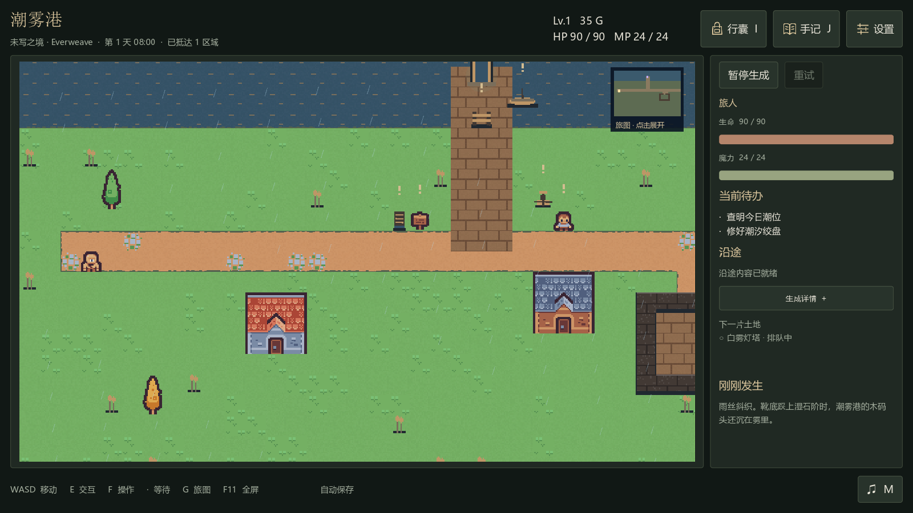
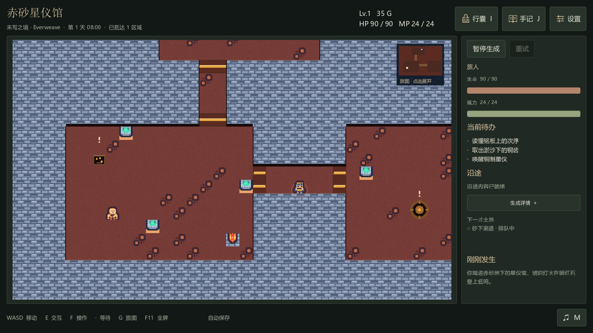
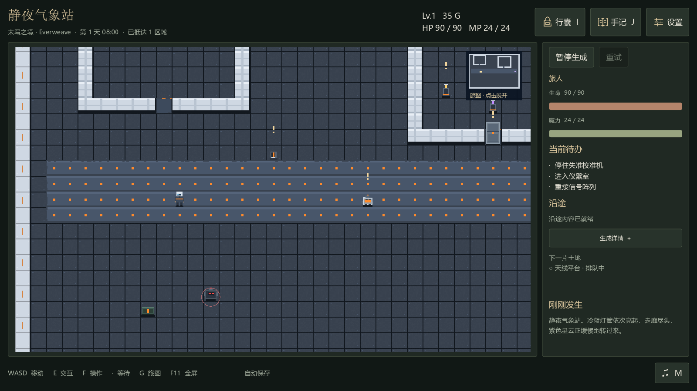

[简体中文](README.md) | English

# Everweave

**A dynamic, LLM-directed pixel JRPG running on Godot 4 and a persistent local runtime.**

Unlike traditional JRPGs where maps and branching narratives are baked into static assets, or pure-text MUDs that lack spatial positioning and tactile feedback, `Everweave` bridges large language model narrative orchestration with the Godot 4 game engine. Models act as global directors and chapter authors to synthesize adventures, puzzles, and encounters on the fly, while a local Python runtime and an embedded rule DSL enforce gameplay solvability, asset coherence, and persistent world state.

---

## Architectural Highlights

* **Hierarchical Director-Author Pipeline**:
  * **Global Director**: Manages overarching character arcs, quest dependencies, resource economies, and multi-stage ending convergences.
  * **Regional Authors**: Synthesize localized room layouts, dialogue trees, combat encounters, interactive puzzles, and audiovisual choices.
* **Dual-Track Asset & Semantic Review Pipeline**:
  * **Decoupled Mechanics & Audiovisuals**: Splits complex region generation into parallel reasoning calls before reassembling and validating them under strict engine contracts.
  * **Optional Jev Semantic Verification**: Integrates TypeSafe Jev validation to detect plot inconsistencies and verify player actions against generated scene logic.
* **Deterministic Rule DSL & Transactional Persistence**:
  * The model outputs constrained, schema-validated JSON containing a domain-specific rule DSL—never untrusted Python or GDScript.
  * Puzzles, inventory exchanges, and map triggers run inside a sandboxed interpreter, committed atomically via SQLite transactions.
* **Persistent Living World**:
  * Opened passages, altered mechanisms, and character relationships persist in the local world database. Exploring earlier territories reveals the lasting consequences of past choices.
* **Dual Runtime Targets**:
  * Native Desktop (Godot 4.7+ window rendering);
  * Browser Web Mode (exports the full Godot client to a local web server for instant browser play).

---

## In-Game Showcase

Visuals rendered in real time by Godot using model-directed layouts and local pixel asset libraries:



| Underground Planetarium | Orbital Weather Station |
| :---: | :---: |
|  |  |

---

## Quick Start

### Requirements
* **Python**: 3.11 or newer
* **Engine**: Godot 4 Standard (tested with Godot 4.7.2)

### Running the Game

#### 1. Native Desktop Client
Place the Godot binary in the repository root or `./tools/Godot.exe`, then execute:

```powershell
python launch.py --godot ./tools/Godot.exe
```
*(On Windows, you can simply run `Start.cmd`)*

#### 2. Browser Client
```powershell
python launch.py --web --data-dir ./userdata/web-journey
```
*(Or run `Start-Web.cmd` and open the local address printed in the terminal)*

#### 3. Offline Demo Mode (Zero API Usage)
To test Godot rendering, client HUD, and controls without spending model quota:
```powershell
python launch.py --demo --data-dir ./userdata/offline-demo
```

---

## LLM Backends & Connection Setup

The in-game connection menu supports multiple model providers:
* **ChatGPT Direct Subscription**: Connects via official device authorization to stream Responses SSE directly with GPT-6 / GPT-5.6 Luna across six configurable reasoning effort tiers.
* **OpenAI-Compatible & DeepSeek Endpoints**: Supports custom Base URLs and API Keys with encrypted local key storage.
* **TypeSafe Jev Service**: Optional semantic validation via encrypted local DPAPI credentials.

---

## License

This project is open-sourced under the [MIT License](LICENSE). Embedded art assets and audio files retain their respective licenses.
