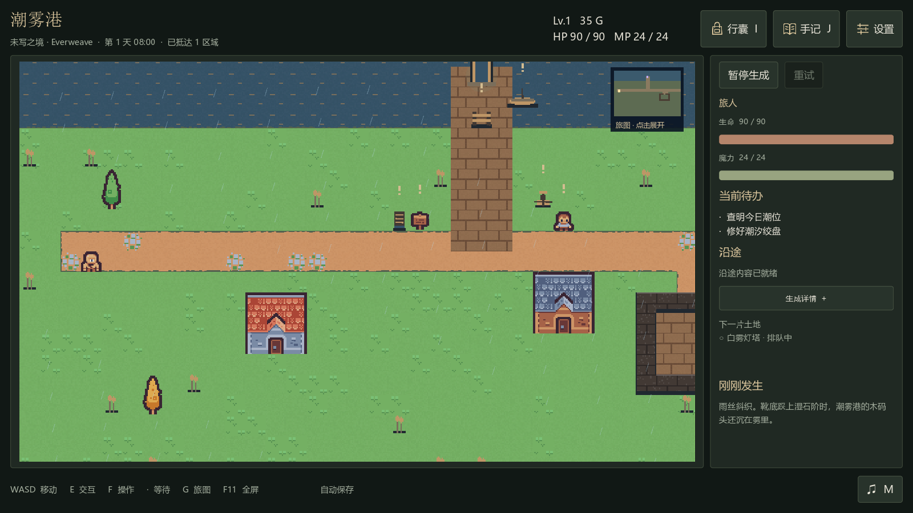
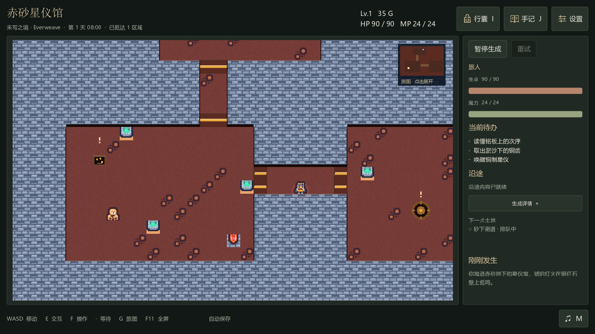
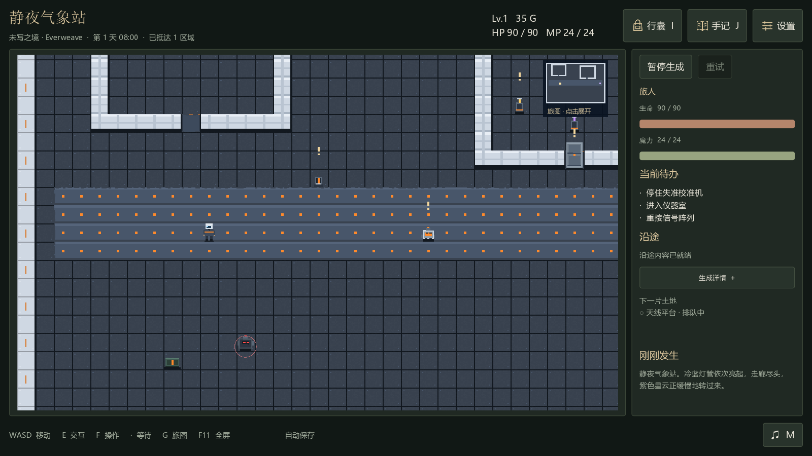

简体中文 | [English](README.en.md)

# Everweave · 未写之境

**由大模型动态编导、Godot 驱动的原生像素风生成式 JRPG**。

在传统游戏中，地图、任务与世界往往是预先烘焙固化的；而单纯的文本跑团又缺少真实的物理触感与空间走位。`Everweave` 将大语言模型的长程叙事编排能力与 Godot 4 像素游戏引擎结合：模型作为“全局导演与章节作者”动态构筑关卡、解谜机关与剧情支线，本地 Python 运行时通过严格的受限 DSL 解释器与 SQLite 事务持久化保证规则可解性与世界连贯性。

---

## 核心设计与创新机制

* **全局导演与内容作者分层制作（Director-Author Hierarchy）**：
  * **全局导演（Director）**：把控主线人物弧光、任务前置依赖、全局经济平衡与多阶段结局收敛方向。
  * **场景作者（Author）**：按需生成具体地块的场景布局、NPC 对白、遭遇战、机关逻辑与视听资产组合。
* **双路并行制作管线与语义审查**：
  * **玩法与视听解耦**：将复杂地块的逻辑规则与视听美术分为两条分支并行生成，再由本地引擎执行强契约校验与拼装。
  * **可选 Jev 语义审查**：集成 TypeSafe 官方 Jev 语义审校，自动校验玩家行为与生成叙事的逻辑自洽性。
* **确定性规则 DSL 解释器（Sandboxed Rule DSL）**：
  * 模型仅输出受模式约束的严格 JSON 格式与规则 DSL，绝不执行任意动态脚本。
  * 解释器接管机关开合、道具置换、战斗判定与历史位置追踪，所有状态变更由 SQLite 原子事务提交，失败自动回滚。
* **真正留存的世界变化（Persistent Living World）**：
  * 玩家开启的通道、重塑的机关、NPC 的好感与生死状态持久留存于世界存档中，随时可以重访故地。
* **双端运行形态**：
  * 原生桌面端（Godot 4.7+ 独立窗口渲染）；
  * 纯浏览器 Web 模式（一键导出 Godot 客户端至本地 Web 服务端）。

---

## 游戏画面实机预览

场景由 Godot 客户端根据大模型编排与本地像素素材集实时组装渲染：



| 地下天文馆 | 轨道气象站 |
| :---: | :---: |
|  |  |

---

## 快速开始

### 环境依赖
* **Python**：3.11 或更高版本
* **游戏引擎**：Godot 4 Standard（推荐 Godot 4.7.2）

### 运行方式

#### 1. 桌面客户端启动
将 Godot 可执行文件放置于根目录或 `tools/Godot.exe`，然后运行：

```powershell
python launch.py --godot ./tools/Godot.exe
```
*(Windows 下可直接双击运行 `Start.cmd`)*

#### 2. 浏览器 Web 端启动
```powershell
python launch.py --web --data-dir ./userdata/web-journey
```
*(或双击运行 `Start-Web.cmd`，启动后根据终端提示在浏览器中打开对应端口)*

#### 3. 离线演示模式（零 API 依赖）
若只想测试客户端渲染与基础交互，无需消耗模型额度：
```powershell
python launch.py --demo --data-dir ./userdata/offline-demo
```

---

## 模型提供商与连接

游戏内置连接配置界面，支持多种大语言模型驱动后端：
* **ChatGPT 订阅直连**：支持 GPT-6 / GPT-5.6 Luna 系列，并提供从 Low 到 Max 的六档深度思考等级，通过官方设备授权直接建立 Responses SSE 会话。
* **OpenAI 兼容端点 / DeepSeek API**：支持自定义 Base URL 与 API Key，凭据本地安全加密存储。
* **Jev 语义审校服务**：可选通过 DPAPI 加密凭据挂载 TypeSafe 官方审校服务。

---

## 许可证

本项目基于 [MIT License](LICENSE) 开源。美术资产与第三方音视频遵循其各自的独立授权协议。
