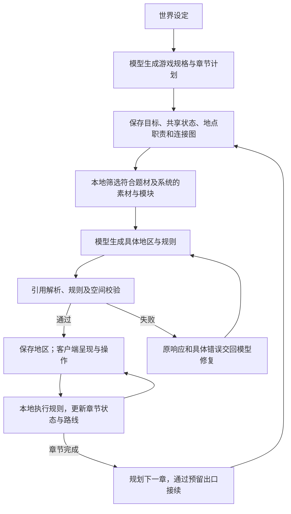

# 章节与游戏规格

本文描述当前章节实现。正常在线新世界通过 `/start` 启用规划；底层地区 DSL 仍沿用 Content Runtime v2。持续人物、内容委托与途中复盘见 [冒险导演](ADVENTURE_DIRECTOR.md)。请新建世界体验，本轮不提供旧世界转换或迁移验收。

## 从设定到冒险



章节规划单独计入模型调用预算，并非每个地区都重新规划整场冒险。规划、地区和局部反应任务共用导演的调用上限、失败记录和修复机制；一次调度步骤最多尝试生成及一次修复。修复仍失败时等待重试，不偷偷换成样例世界。

## 游戏规格 `game_spec`

第一章必须提供游戏规格，后续章节不得替换。规格随世界保存，包含：

| 字段 | 当前作用 |
|---|---|
| `identity` | 玩家角色称谓 |
| `inventory_label` / `journal_label` | 物品和记录面板的世界内名称 |
| `visual_theme` | 时代、题材与视觉方向，参与素材适配检查 |
| `systems` | `combat`、`inventory`、`equipment`、`progression` 四个开关 |
| `resources` | 0～8 种资源，含 `id/label/initial/max/display`；`display` 为条形或数字 |
| `failure_mode` | `checkpoint`、`end` 或非战斗世界的 `none` |

资源范围从 0 到声明的 `max`，最大值为 1～100000 的整数。`hp/mp/gold` 是可选内置资源；启用战斗时必须有 `hp`，表示剩余健康量。装备依赖物品系统。其他 ID 可以表达弹药、感染、电量、温度等，使用同一套有界数值接口。

```json
{"get":"resources.ammo"}
```

```json
{"op":"resource","id":"ammo","delta":-1}
```

省略的内置资源不能继续被规则使用；关闭战斗后拒绝敌人和战斗操作，关闭装备后拒绝武器/饰品物品。相关面板和数值也随规格隐藏或改名。设定不足以单独证明规则合理，例如感染达到上限是否造成伤害，需要模型用条件与效果表达。

`checkpoint` 在健康耗尽时退回当前地区入口并恢复健康，不自动扣货币，也不补充弹药。`end` 结束本局，停止新生成和后续游戏动作；仍可关闭消息并从设置新建世界。非战斗世界默认 `none`，不暗中加入死亡惩罚。

这是有限能力的配置层，不是任意玩法引擎：当前战斗仍依赖 `hp`，启用装备时仍使用既有武器/饰品槽，设置、存档、语言和音量等系统界面仍由客户端实现。

## 章节计划 `kind=campaign`

外壳为 `{"kind":"campaign","campaign":{...}}`。章节包含 `title/premise/goal`、`flags`、`flag_sources`、可选的 `item_sources`、`regions`、`links`、`milestones`、`complete_when` 和 `continuation`。

- 新在线默认 `planning:rolling`，先规划 2～4 个地区及私有 `ending_brief`，中段由导演追加。`planning:chapter` 保留原来的 4～8 地区整章模式。第一个地区是到达点。
- 初始每章 4～14 条连接，默认双向，可设置 `one_way=true` 表示仅从 a 到 b。必须有回环和交汇点，沿允许方向从入口能够结构性到达所有地区。初始每个地点最多六条章内物理路线；跨章接续与后续导演预留门另计。

上述最少连接数、回环和交汇点要求适用于整章模式。滚动开局允许从一小段相连地点开始，所有初始地点仍须沿允许方向可达；后续扩展应形成分支和交汇，运行时不保证模型每次都设计出有趣的网络。
- 地区 ID 最长 20 字符，连接 ID 最长 40 字符。引擎提供短而稳定的实际锚点名，模型照抄 `planned_routes[].anchor`，不自行推算。
- `flags` 是本章共享标量；`flag_sources` 为每个标量指定负责产生它的地区。地区校验会检查是否包含对应写入效果，但不能证明该效果一定能触发。
- `item_sources` 声明本章关键道具：`{ITEM_ID:{region,count?}}`，`count` 为 1～9，默认 1，需要启用物品系统。产出地区在上下文里收到 `required_item_grants`，要用同名 `items` 定义让玩家拿到；运行时按 `地区ID:道具ID` 读背包。
- `milestones` 是面向玩家的阶段目标；`complete_when` 决定章节完成。

## 条件

`links.requires/discover`、`milestones.when`、`complete_when` 以及任务的 `when/fail_when/reveal_when` 共用一种条件列表，条目之间只有 AND：

| 写法 | 含义 |
|---|---|
| `{"flag":"power","eq":true}` | 本章旗标等于该值，类型须与声明一致 |
| `{"item":"fuse","count":2}` | 背包里至少有 2 个本章 `item_sources` 声明的道具，`count` 默认 1 |
| `{"ability":"listen"}` | 玩家已学会冒险技能 `listen` |
| `{"mission":"meet","status":"complete"}` | 任务处于 `active/complete/failed` 之一 |

运行时 `refresh`、门的 `sync_gates` 和旅图都按真实状态（旗标、背包、已学能力、任务状态）求值。章节和导演计划里的本地任务 ID 在安装时改写成带前缀的正式 ID。地区规则内要判断能力时用表达式 `{"has_ability":"listen"}`。

例如电站的规则可以写入：

```json
{"op":"chapter","key":"power_restored","value":true}
```

本章其他地区读取 `{"get":"chapter.power_restored"}`。局部机关状态仍放在 `vars` 或对象状态里，跨地区依赖使用章节状态。状态按章节隔离保存，返回旧章时不会误读新章的同名变量。

## 连接、隐藏与接续

`links` 使用 `a/b` 指向本章地区。`requires` 决定是否能通行；隐藏连接通过 `hidden` 和非空 `discover` 条件揭示。已经揭示的路线不会因为发现条件后来变化而重新隐藏，但通行条件仍实时判断。

每个地区为所有计划路线预留独立锚点，包括尚未发现的路线。实际出口由引擎创建，跨区通过同一连接的对应入口到达；平行路线可以保有不同门口。旅图显示已到访地区和它们已经揭示的道路，不把后台预生成当作玩家知识。锁闭道路仍显示状态，路线标记避开锁闭连接。

有章节计划时，地区不再提交 `destinations` 或自行增加 `forward_N/back`；局部反应也不能用 `locations/future_updates` 改写章节路线。共享状态改变既有连接，`direction` 可通过预留门添加当前章内连接，下一章引入新地点。单向连接的另一端保留到达锚点，但不提供反向出口；旅图标记路线也遵循方向。

`continuation.from` 指定本章接续地点，该地区必须预留可达且空闲的 `chapter_gate`。完成后，导演生成下一章，把它连接到旧章接续点，保留返回路线与旧章状态。跨章目前采用这种接续方式，未提供任意连接到所有历史地点的编辑接口。

## 题材与原创

关键词结合 `visual_theme` 区分现代、科幻、小镇和地下方向。现代医院/感染题材优先于“地下”一词，避免误选中世纪角色。没有合适图像时会给模型空候选，要求原创；现代/科幻规格也检查不相容的角色和物体引用，通用地表与植被可复用。

检索不再额外偏爱冒险者、史莱姆等名称；模块按系统过滤，例如没有魔力时不推荐依赖 MP 的 `duel_v1`。当前库仍以小镇/地下为主，分类仍是关键词和标签规则，不能保证理解所有混合题材。

## 通关证明（`engine/progression.py`）

章节计划通过结构校验后，引擎在章节抽象图上做穷举搜索。状态是（所在地区、旗标、道具计数、已学能力、任务状态，外加已兑现的产出与已揭示路线）。规则：

- 到达地区即可兑现它承诺的产出：`flag_sources` 指向它的旗标可以写成任何被条件引用过的值（因此失败分支也会被搜到）；`item_sources` 的道具按声明数量各给一次；带 `skills` 的委托在其 `requires` 任务完成后可学会这些技能。导演追加旗标时，写入它的委托的 `requires` 同样是前提。
- 路线按 `requires`、`hidden/discover`（揭示后不再隐藏）、`one_way` 行走；任务完成与失败、隐藏路线揭示按运行时 `refresh` 的顺序结算。
- 终点：存在全部依赖都在本章（或已完成）的 `final` 结局时，以到达这样的结局为终点；否则以本章 `complete_when` 为终点，交给下一章接续。

必须同时证明：从开局能到达终点（给出一条见证路径）；每个计划地区在某个可达状态下能到；任何可达状态都仍能到达终点，否则报出软锁状态和导致它的步骤。状态数上限 100000，超限直接拒绝。失败都以 `InvalidPatch` 返回，走原有的「原响应 + 具体错误交回模型修复」路径。

导演 `direction` 先在探针世界里试装，再从玩家当前位置和真实状态重新证明当前章节；新地点必须在某个可达状态下能到。

章节计划还必须有一处真实的锁（`progression.require_lock`）：只保留开局即可通行的路线（删去 `requires` 开局不成立的路线和尚未揭示的隐藏路线），若终点仍可到达就拒绝。玩家已拥有的能力（`campaign.validate(..., abilities=)`，来自上一章）计入开局，所以要求已会能力的路线不算锁；`graph_from_plan(plan, existing, abilities)` 同样带着这些能力规划。滚动规划因此至少要 3 个地区。

这一层只证明章节骨架，道具在章节层按只增不减处理。跨章节的旧任务在搜索中冻结为当前状态。

## 地区生产合同（`engine/region_search.py`）

地区内容提交前，`check_region(world, parsed, context)` 在探针世界里装入该地区，用真实解释器穷举地区内状态，证明它兑现章节承诺：

- 合同：`item_sources` 指向本地区的道具按声明数量都能拿到；`flag_sources` 指向本地区（且不由委托写入）的旗标，能达到章节条件（路线 `requires/discover`、里程碑、`complete_when`、本章任务 `when`）引用过的每个非初始值（`campaign.promised_values`）。
- 外部输入：在章节图上去掉本地区的产出后跑 `progression.explore`，把可得的外地道具、能力并入开局；本地区内容或本地区路线读取的外地旗标，按可达值枚举开局组合（最多 64 组），并只允许离开后向非初始值推进。
- 宏动作：走到实体可交互格（`scene.routes_from` / `path_to`，逐步执行真实 `move`）并交互，再分支每个可用的 `content_action`、对话选项、可负担的购买；调用玩家自身的探索动作；使用可用道具；战斗按第一个可用战斗动作自动打到结束；能走到开放出口时还可离开后从任一开放入口重进、或推进外地旗标。抵达最终结局是终态，失败结局剪枝。
- 状态键：背包、能力、资源、本章旗标与路线揭示、任务和角色状态、事实、地区运行时变量和已用动作、实体与道具的位置/消耗/阻挡/上锁、地图格，以及玩家所在的连通区域；排除生命、时间与巡逻敌人位置。
- 拒绝条件：任一承诺达不到（含钥匙只在需要它自己的锁后）；任一可达状态再也拿不到承诺道具、再也让承诺旗标达到承诺值之一，或再也走不到开放出口（软锁，给出导致它的步骤）；状态超过 3000 上限。错误以 `InvalidPatch` 交回模型修复。

通过时地区 `playability.progress` 记录 `status='verified'`、状态数、合同条目、外部输入和每个条目的见证步骤。委托工人教的能力按章节输入处理；计时器只记 ID 不记剩余量，巡逻敌人位置不进状态，战斗只试一种打法。

## 验证边界

章节结构和共享状态有自动测试，实际模型也生成了医院计划及地区。章节骨架的可通关性和地区是否兑现承诺由上面两层搜索证明；完整实机跨区域通关、长时间章节接续和谜题平衡尚未完成，见 [交付记录](CAMPAIGN_VALIDATION.md)。剧情是否精彩不在证明范围内。
